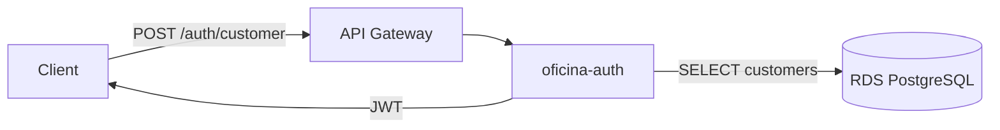

# oficina-auth-lambda

Function serverless de **autenticação do cliente por CPF**. Fica atrás do API Gateway em `POST /auth/customer` e devolve um JWT aceito pelas rotas protegidas dos microsserviços.

## Funcionamento

1. Valida o CPF (formato e dígitos verificadores).
2. Consulta o cliente na base do `os-service` e verifica se está ativo.
3. Gera um JWT (HS256, 1 hora) com `sub` igual ao id do cliente e `role` igual a `CUSTOMER`.

| Situação | Resposta |
|---|---|
| CPF inválido | 400 |
| Cliente não encontrado | 401 |
| Cliente inativo | 403 |
| Sucesso | 200 com `accessToken`, `tokenType` e `expiresIn` |

A function tem acesso somente de leitura à tabela `customers`. Com o token, o cliente consulta a própria OS (`GET /service-orders/:id/status`) e aprova ou recusa o orçamento (`POST /budgets/:orderId/decision`).

## Tecnologias

Node.js 22, TypeScript, `pg`, `jsonwebtoken`, esbuild, Jest, Terraform, AWS Lambda e API Gateway HTTP API.



## Execução local

```bash
npm install
```

```bash
npm test
```

Para testar a chamada HTTP, o `docker-compose.yml` em `oficina-infra-k8s/local` sobe a function atrás de um servidor HTTP em `http://localhost:3000/auth/customer`:

```bash
curl -X POST http://localhost:3000/auth/customer -H "Content-Type: application/json" -d '{"cpf":"529.982.247-25"}'
```

## Deploy

A pipeline roda lint, testes, empacotamento e SonarCloud em todo pull request. Em `develop` aplica o Terraform de `infra/` criando `oficina-auth-hml` na rota `POST /hml/auth/customer`; em `main` cria `oficina-auth-prod` na rota `POST /auth/customer`.

Recursos criados: function, role de execução, security group, integração e rota no API Gateway existente (criado por `oficina-infra-k8s`).

| Tipo | Nome |
|---|---|
| Secrets | `AWS_ACCESS_KEY_ID`, `AWS_SECRET_ACCESS_KEY`, `SONAR_TOKEN`, `JWT_SECRET`, `DATABASE_URL` |
| Variables | `AWS_REGION`, `TF_STATE_BUCKET`, `SONAR_PROJECT_KEY`, `SONAR_ORGANIZATION` |

`DATABASE_URL` aponta para o banco do `os-service` do ambiente, sem o parâmetro `sslmode` (o TLS é ligado por `DATABASE_SSL`). `JWT_SECRET` é o mesmo dos microsserviços.

Deploy manual:

```bash
npm run package
```

```bash
cd infra && terraform init -backend-config="bucket=<bucket>" -backend-config="key=auth-lambda/prod/terraform.tfstate" -backend-config="region=us-east-1" && terraform apply -var environment=prod
```
